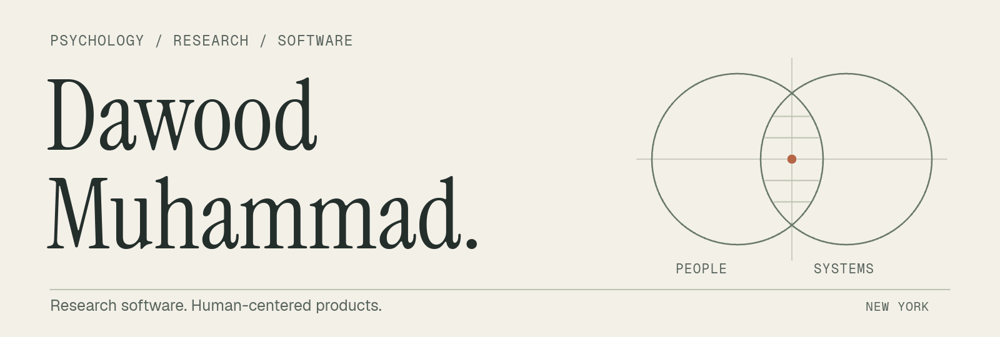
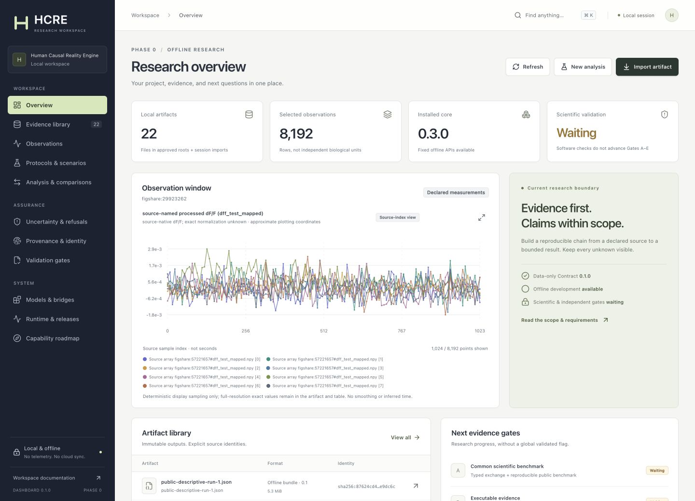

<picture>
  <source media="(max-width: 600px)" srcset="assets/masthead-mobile.png">
  
</picture>

  <a href="https://github.com/Dawood-Muhammad/human-causal-reality-engine">Code</a>
  &nbsp; · &nbsp;
  <a href="SELECTED-WORK.md">Work</a>
  &nbsp; · &nbsp;
  <a href="https://www.linkedin.com/in/dawood-muhammad-135946328/">LinkedIn</a>
  &nbsp; · &nbsp;
  <a href="mailto:Dawoodman@outlook.com">Contact</a>

### I turn questions about people into working software.

I'm a **Stony Brook psychology graduate** building research tools, AI evaluations, and interactive behavioral experiments. My experience in behavioral research and frontline care shapes the work: clear evidence, visible uncertainty, and meaningful choices for the person using it.

PYTHON &nbsp; / &nbsp; TYPESCRIPT &nbsp; / &nbsp; REACT &nbsp; / &nbsp; FASTAPI &nbsp; / &nbsp; SQL &nbsp; / &nbsp; RESEARCH DESIGN

## Featured work

### Human Causal Reality Engine

A local research workbench that keeps **source evidence, analysis, and reproducible results** together. I built the Python core, React dashboard, and offline verification workflow.

  

**[Explore the code ↗](https://github.com/Dawood-Muhammad/human-causal-reality-engine)** &nbsp; · &nbsp; [Run an example](https://github.com/Dawood-Muhammad/human-causal-reality-engine#try-it) &nbsp; · &nbsp; [Review the engineering](https://github.com/Dawood-Muhammad/human-causal-reality-engine#review-the-engineering) &nbsp; · &nbsp; [CI results](https://github.com/Dawood-Muhammad/human-causal-reality-engine/actions/workflows/ci.yml)

Public source · MIT · Active R&D. Fixed analyses and replay are implemented; causal prediction and independent scientific validation remain future work. The screenshot's measurement rows are not independent animals or experiments.

 

## More work

**[Neural Intent Lab ↗](SELECTED-WORK.md#neural-intent-lab)** &nbsp; `Python` `TypeScript` 
EEG evaluation paired with a sandbox that separates a model's score from permission to act.

**[EquityBench ↗](SELECTED-WORK.md#equitybench)** &nbsp; `Python` `AI evaluation` 
Replayable de-identification checks with separate limits for privacy misses and useful text removed.

**[Cognitive Bias Lab ↗](SELECTED-WORK.md#cognitive-bias-lab)** &nbsp; `React` `Experimental design` 
Four interactive behavioral tasks with transparent methods and a delayed debrief.

These are public case studies of private-source prototypes. Their evidence and limitations are documented in the gallery.

**[View all seven projects ↗](SELECTED-WORK.md)**, including ShiftLens, Memory Distortion Studio, and How to Show Up.

 

## Reproducible AI behavior evaluations

I am also finishing a set of **private research repositories** that evaluate language-model behavior with explicit methods, frozen evidence, and visible limits. They are not public products, and they are not completed. Source is private; the descriptions below follow those repositories' own documentation.

**[llm-personality-reliability](https://github.com/Dawood-Muhammad/llm-personality-reliability)** &nbsp; `Python` `Psychometrics` 
How consistent are LLM personality-test responses? Test-retest, alpha, and ICC across prompts, sampling settings, and models. Reliability here is consistency under a stated design, not a claim of model personality.

**[assessment-scoring-assistant](https://github.com/Dawood-Muhammad/assessment-scoring-assistant)** &nbsp; `Python` `Assessment` 
Inspect ratings, rubric anchors, and disagreements on synthetic vignettes. Research and education only — not for clinical use. A small helpfulness-judge pilot was unfavorable relative to a training-majority baseline.

**[llm-cognitive-bias-audit](https://github.com/Dawood-Muhammad/llm-cognitive-bias-audit)** &nbsp; `Python` `Cognitive bias` 
Reproducible judgment-task trials with effect sizes, exclusions, and visible limits. Recorded command-route outputs are not approved real-model acceptance (0 of 56 eligible).

**[synthetic-case-note-checker](https://github.com/Dawood-Muhammad/synthetic-case-note-checker)** &nbsp; `Python` `Source-bound review` 
Review public research statements against a pinned source, and check fabricated case notes offline. This is research software, not a clinical product.

These repositories are private. The counts and limits above are taken from their own documentation; this profile does not add new results.

 

---

**Good research needs good tools.** 
[Let's talk about what you're building.](mailto:Dawoodman@outlook.com)
